# BÁO CÁO BÀI TẬP THỰC HÀNH LẬP TRÌNH C# WINFORMS

## I. THÔNG TIN SINH VIÊN

* **Họ và tên:** Hoàng Nghĩa Bảo
* **Mã số sinh viên:** 24810320182
* **Lớp học phần:** Lập trình .NET - Mã học phần: 0101004755

* **Link Repository:** [https://github.com/nghiabao2006-commits/LTNET-TEST02_24810320182_HoangNghiaBao](https://github.com/nghiabao2006-commits/LTNET-TEST02_24810320182_HoangNghiaBao)

---

## II. DANH SÁCH BÀI TẬP HOÀN THÀNH & TỰ ĐÁNH GIÁ

| Bài tập | Tiêu đề bài tập | Trạng thái | Mức độ hoàn thành (%) |
| :---: | :--- | :---: | :---: |
| **Bài 1** | Quản lý Dịch vụ Phòng Gym & Hội viên | Hoàn thành | 99% |
| **Bài 2** | Báo cáo & Lưu trữ Tài liệu Nhà sách | Hoàn thành | 99% |
| **Bài 3** | Hệ thống MDI Quản lý Bệnh viện & Async | Hoàn thành | 99% |
| **Bài 4** | BẢNG ĐIỀU KHIỂN THỐNG KÊ DOANH THU  | Hoàn thành | 99% |
| **Bài 5** | MÔ PHỎNG GIÁM SÁT TỶ GIÁ TÀI CHÍNH | Hoàn thành | 99% |


---

## III. MINH HỌA GIAO DIỆN & KỸ THUẬT NỔI BẬT

### 1. Bài 1: Quản lý Dịch vụ Phòng Gym & Hội viên
* **Kỹ thuật áp dụng:** Cấu hình DataGridView bằng code (`AutoGenerateColumns =
false`), Data Binding 2 chiều với `BindingSource`, Validation với `ErrorProvider`.
* **Hình ảnh minh họa Giao diện:**

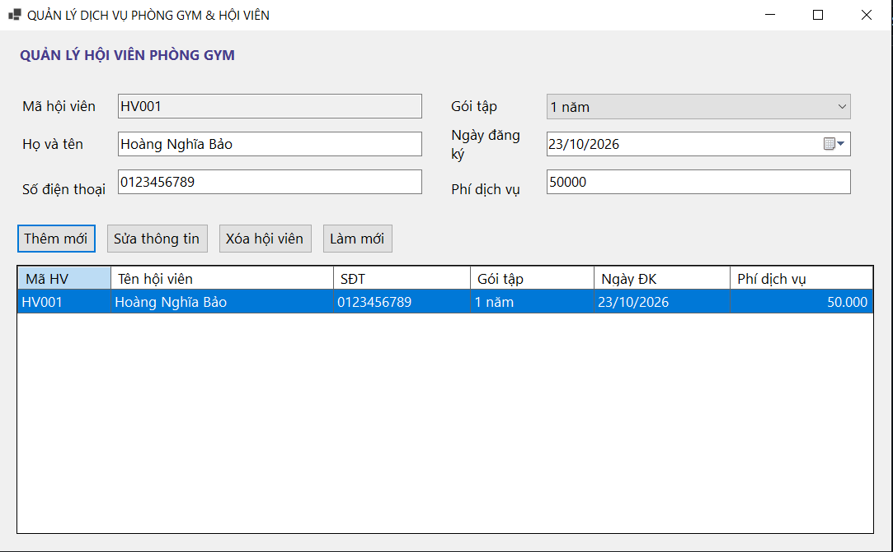

*Mô tả: Giao diện chính hiển thị DataGridView và đồng bộ dữ liệu 2 chiều lên các
TextBox.*

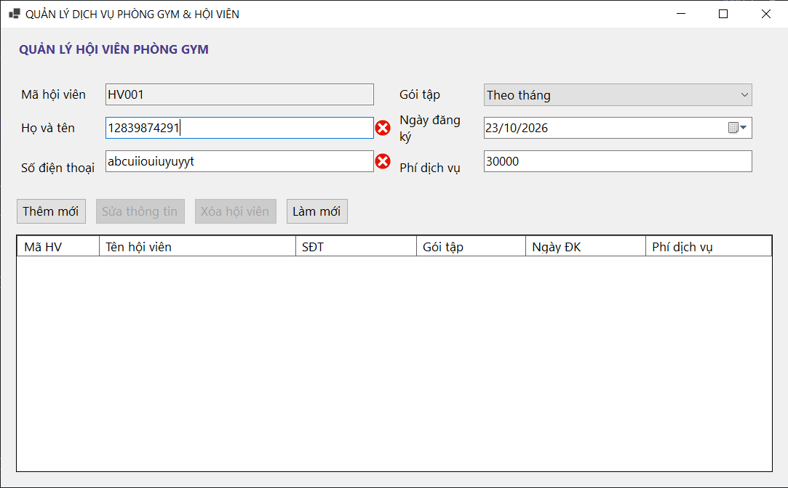

*Mô tả: Kiểm tra hợp lệ dữ liệu nhập vào bằng ErrorProvider khi nhấn Thêm mới.*

---

### 2. Bài 2: Quản lý & Xuất Báo cáo Nhà sách
* **Kỹ thuật áp dụng:** `OpenFileDialog` (Tải ảnh bìa), `SaveFileDialog` /
`OpenFileDialog` (Đọc/Ghi file CSV), Cập nhật `StatusStrip` theo thời gian thực.
* **Hình ảnh minh họa Giao diện:**

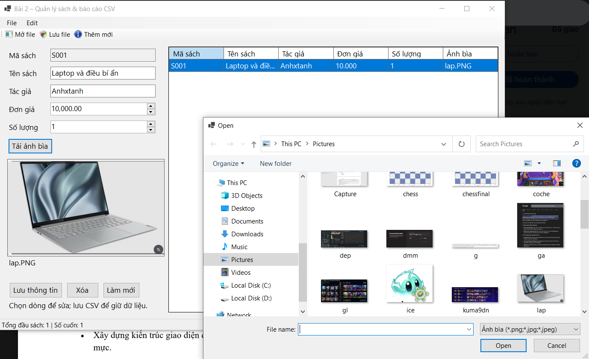
*Mô tả: Chọn ảnh bìa sách từ đĩa cứng hiển thị lên PictureBox và nạp dữ liệu từ file
CSV.*

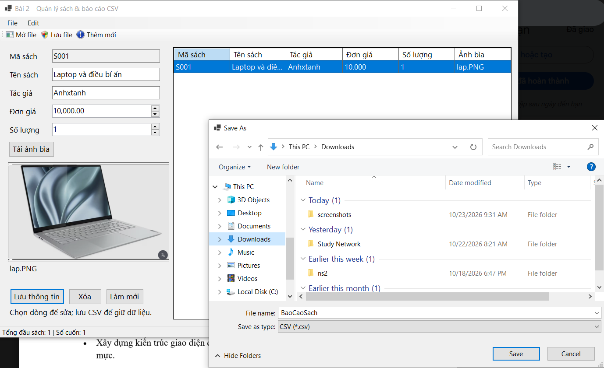
*Mô tả: Xuất file CSV.*
---

### 3. Bài 3: HỆ THỐNG MDI QUẢN LÝ BỆNH VIỆN & TRUY XUẤT HỒ SƠ BỆNH ÁN
* **Kỹ thuật áp dụng:** MDI Container, Quản lý chống mở trùng Form con,
`async/await` chống treo UI, Safe Cross-Thread bằng `this.Invoke()`.
* **Hình ảnh minh họa Giao diện:**

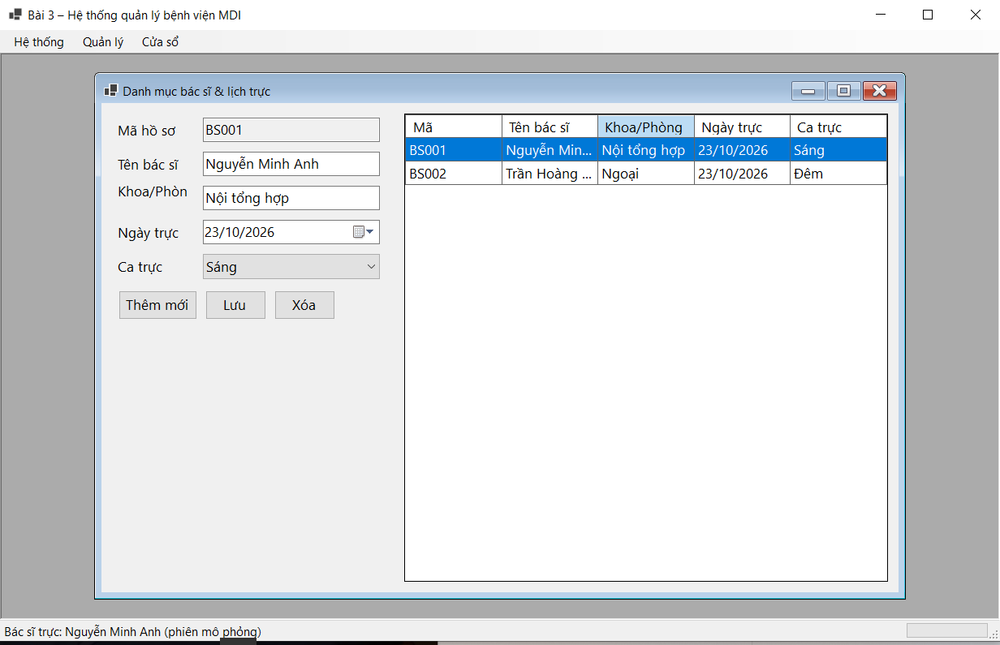

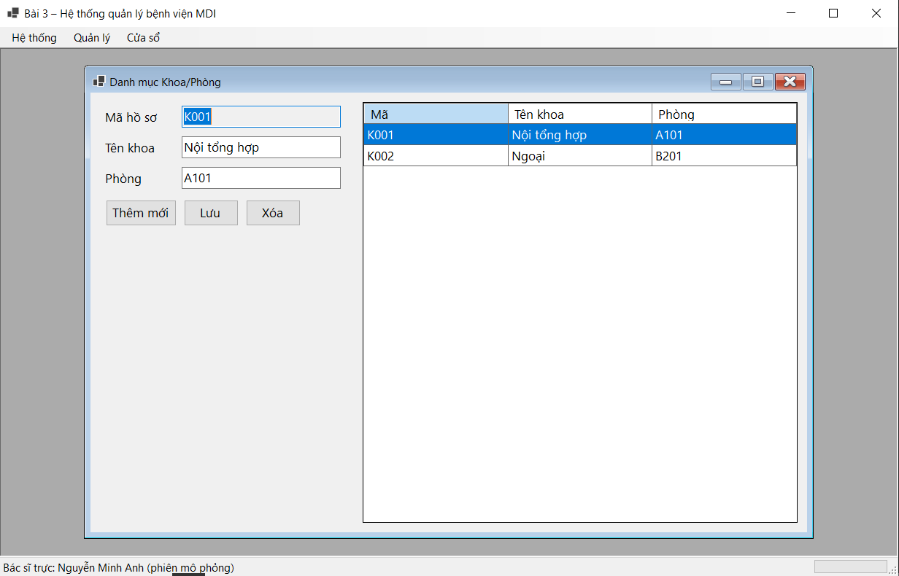

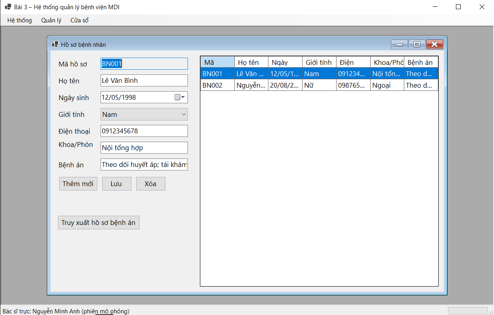

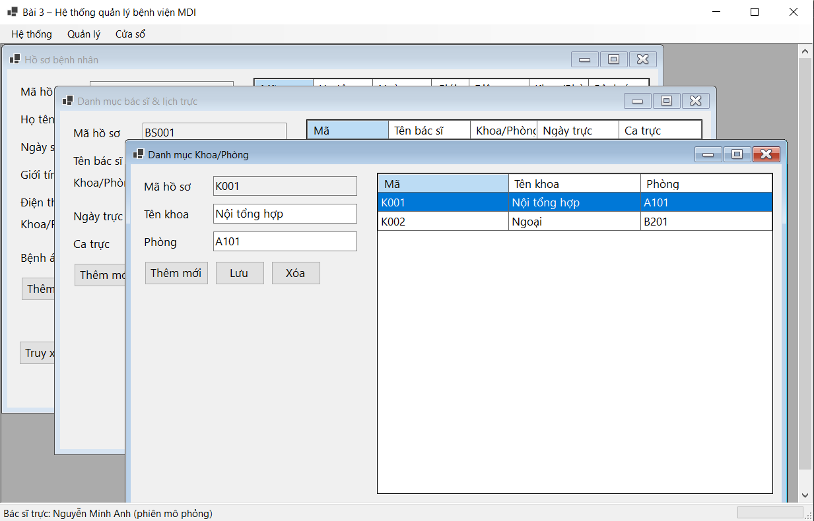
*Mô tả: Khung Form cha MDI điều khiển mở các Form con xếp tầng.*

### 4. Bài 4: BẢNG ĐIỀU KHIỂN THỐNG KÊ DOANH THU MULTI- THREADING (ASYNC/AWAIT & KHÔNG KHÓA UI)

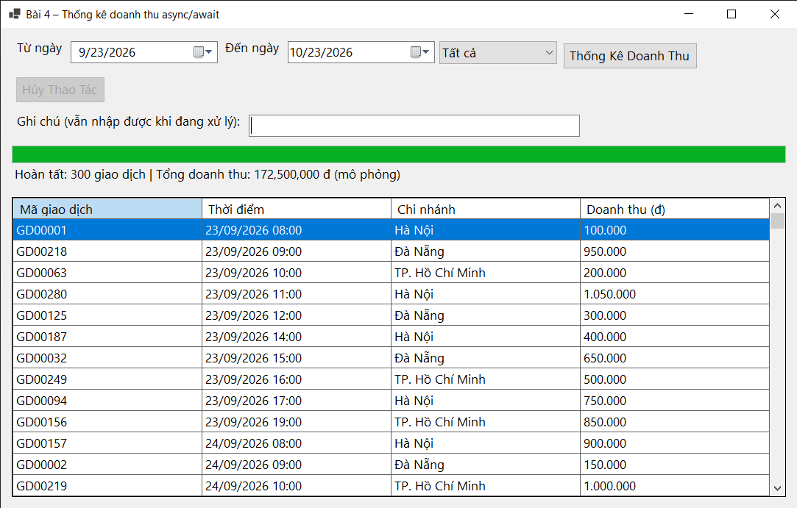

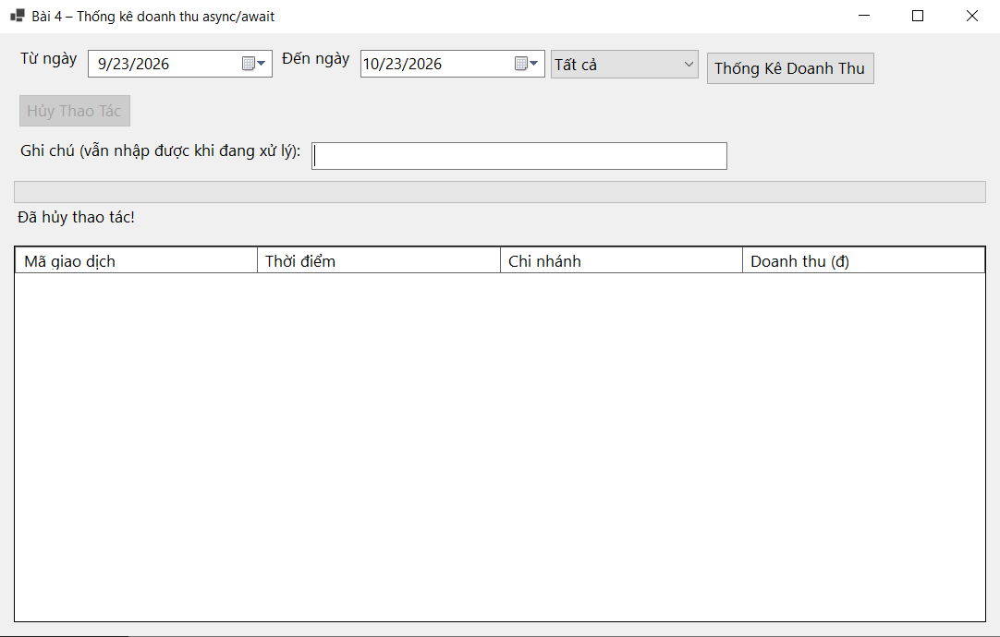

---

### 5. Bài 5: MÔ PHỎNG GIÁM SÁT TỶ GIÁ TÀI CHÍNH THỜI GIAN THỰC (CROSS-THREAD SAFETY & PROCESSING)

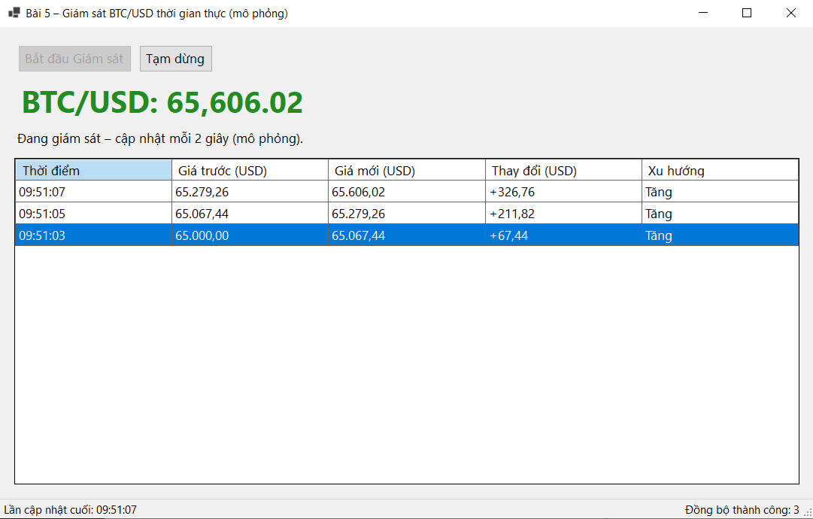

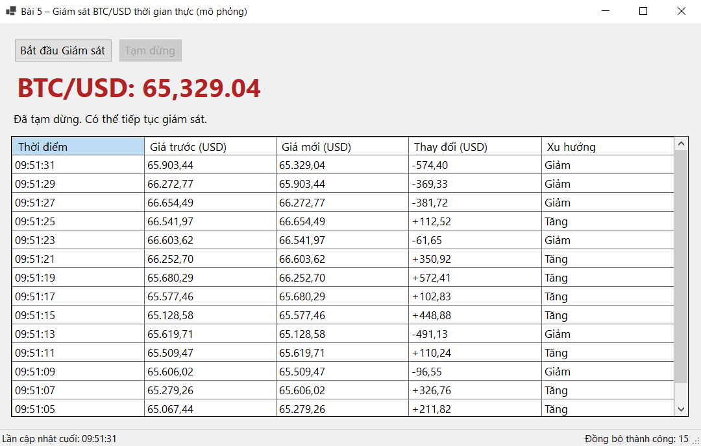

---
## IV. HƯỚNG DẪN CÀI ĐẶT & CHẠY DỰ ÁN
1. Clone Repository về máy:
```bash

git clone [https://github.com/nghiabao2006-commits/LTNET-TEST02_24810320182_HoangNghiaBao](https://github.com/nghiabao2006-commits/LTNET-TEST02_24810320182_HoangNghiaBao)

2. Mở file solution src/WinFormsAppSolution.sln bằng Visual Studio 2022.
3. Bấm F5 hoặc chọn Start để biên dịch và chạy chương trình.
